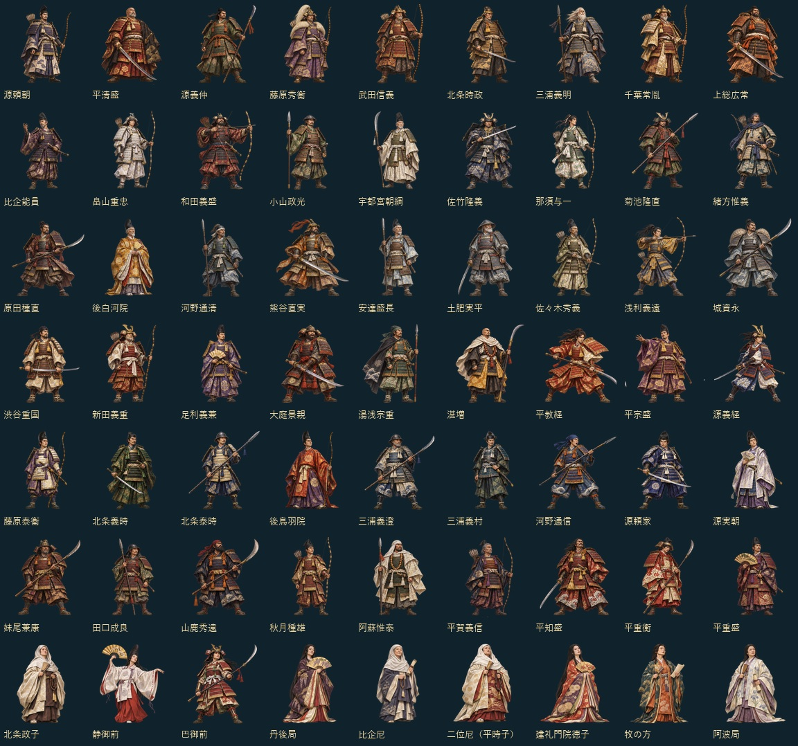

# Kamakura — 挙兵前夜から承久の乱へ

YYシリーズのリアルタイムストラテジー。**1179年1月から1221年7月までの日本**を舞台に、40勢力・46か所の固定拠点を争います。[YYMongolia](https://github.com/ykwyuta/yyMongolia) のRustエンジン、武士・日本建築の画像、地形描画、海上輸送、外交、保存、Windows／Web基盤を流用しています。



## 遊ぶ

Windows版：

```powershell
cargo run --release --locked --bin yykamakura-win
```

Web版（RustのWasmターゲットとNode.jsが必要。npm依存パッケージの追加は不要）：

```powershell
rustup target add wasm32-unknown-unknown
npm run build
npm run preview
```

<http://localhost:8766/> を開きます。Linuxでは `bash build.sh` も利用できます。`dist/` が静的配信成果物です。

## ルール

- **拠点は固定**：蛭ヶ小島、鎌倉、六波羅、福原、屋島、彦島、平泉、胆沢、多賀国府、各武家の館・荘園など。邑・街の新設と焼き払いはできません。田・兵営・要塞・港は建設できます。
- **各家に固有の英雄**：頼朝・清盛・義仲・秀衡・時政・義時・義経・泰時・後鳥羽院など63人。各英雄は一体だけ存在し、敗れると所属勢力の拠点で即時復活します。死去時期が来ると、併合先にいても退場し、復活しなくなります。生没年不詳の人物の扱いは[史実と採用値](docs/history.md)を参照。
- **全拠点喪失で併合**：最後の拠点を失った家の兵・英雄・資源・施設を攻略者が引き継ぎます。一拠点だけの喪失では併合されません。プレイヤーも併合先を操作して続行します。
- **月単位の史実イベント28件**：挙兵、東国武士の結集、頼朝と義仲の和議、法住寺合戦、広常誅殺、義経の離反と平泉入り、奥州合戦、比企・畠山・和田の政変、実朝暗殺、承久の乱など。同盟は強制休戦で表し、史実の敵対開始時に解除します。プレイヤーにも適用されます。
- **朝廷の保護**：1221年5月まで最後の拠点の攻略・併合を防ぎます。承久の乱発生と同時に解除されます。
- **決着**：1221年7月に終了し、支配拠点が最多なら勝利。同数首位も勝利です。史実の戦勝による領有の強制上書きは行わず、実際の攻略で帰属が決まります。先に併合された家のイベントは継承勢力に適用し、同一勢力内の対立で自動的に再独立はしません。

1年48秒、標準速度で約34分。部隊選択中は時間停止。前半・後半とも時間の流れは共通です。武士・和弓兵・騎馬武者・軍船を使用し、国内商人の交易と資源経済も流用しています。

政子・静・巴に加え、丹後局・比企尼・二位尼・建礼門院徳子・牧の方・阿波局が登場します。巴は戦闘型、他の8人は攻撃力0の政治・文化・後援型。政子は軍の攻撃と兵站、静は舞による士気など、所属する勢力への支援効果を持ちます。支援は併合先へ引き継がれ、本人の退場で終了します。

## 操作

タイトルの地図、または勢力選択の◀▶で開始勢力を選びます。密集地域はボタンで選択できます。

左クリックで選択、ドラッグで範囲選択、右クリックで移動・攻撃・採集。矢印・中ドラッグで地図移動、ホイールで拡大縮小、Homeで本拠。A進軍、S停止、T訓練、Space一時停止、＋／−速度。H英雄図鑑、F1遊び方、F2外交、F3歴史、F5保存、F11全画面。

## 保存

Kamakura専用の `YYKM` ヘッダー・v2形式、拡張子 `.yyksav`。Windowsは `%APPDATA%/yykamakura/saves/`、Webは専用のIndexedDB `yykamakura` を使用します。英雄の状態、所属、併合の継承関係、月途中の年代、処理済みイベントを保存します。Mongoliaの保存とは互換性を持ちません。

## 検証

```powershell
cargo test --release --locked --lib
npm test
npm run build
npm run smoke
cargo build --release --locked --bin yykamakura-win
```

30件のRustテストで固定拠点、英雄の復活・死去、義経の所属変更、併合、朝廷保護、同盟・敵対の月、保存と破損拒否、建設・戦闘、1179〜1221年の全AI進行を検証します。Nodeのテストはブラウザのキャッシュ更新と保存保護を検証します。Wasmスモークは本番ABIで画面を確認します。

## 開発

| ファイル | 内容 |
|---|---|
| `src/world/campaign.rs` | 英雄の活動期間、復活、継承、固定拠点名、終了条件、専用テスト |
| `src/world/history.rs` | 年・月付きの史実イベントと効果 |
| `src/geo.rs` | 日本地図範囲、40勢力と初期拠点、地形生成 |
| `src/world/conquest.rs` | 併合、固定拠点の焼き払い禁止 |
| `src/world/heroes.rs` | 固有英雄の名前・性能・説明 |
| `src/art/historical.rs` | 日本の武士・建築画像の選択 |
| `src/world/save.rs` | 英雄と継承関係を含む保存形式 |
| `src/game.rs` | 共通UI、入力、勢力選択、月表示、操作説明 |
| `web/`・`src/win/` | ブラウザ／Windowsの描画・保存 |

海岸線はYYMongolia同梱の[Natural Earth](https://www.naturalearthdata.com/)（パブリックドメイン）。当時の海岸線を厳密に復元したものではありません。既存資材の生成記録は `assets/period/generation.json`。英雄63人には画像生成スキルで制作した固有の透明背景画像を割り当て、マップ・選択欄・Hの英雄図鑑に表示します。[英雄一覧画像](assets/heroes/catalog.jpg)と[生成プロンプト全7件](assets/heroes/generation.json)を同梱。原画は `assets/heroes/sheet-1.png` 〜 `sheet-7.png`、切り出しとBGRA変換は `python tools/import_hero_art.py`（Pillowが必要）。初期領有・拠点の独立性にはゲーム上の整理があります。詳細は[制作・史実ノート](docs/history.md)。UIの三言語基盤は流用していますが、Kamakura固有の年表・人物説明は日本語です。
